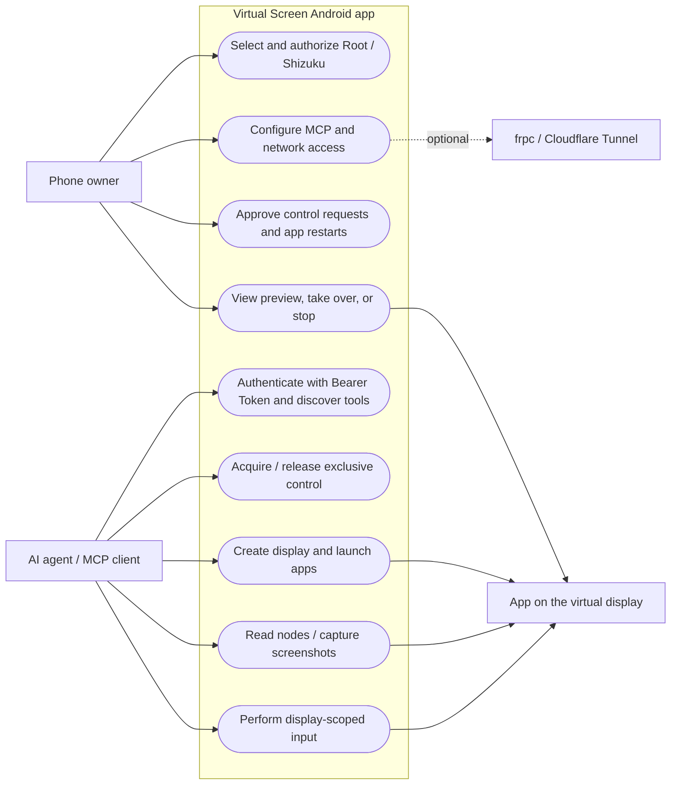
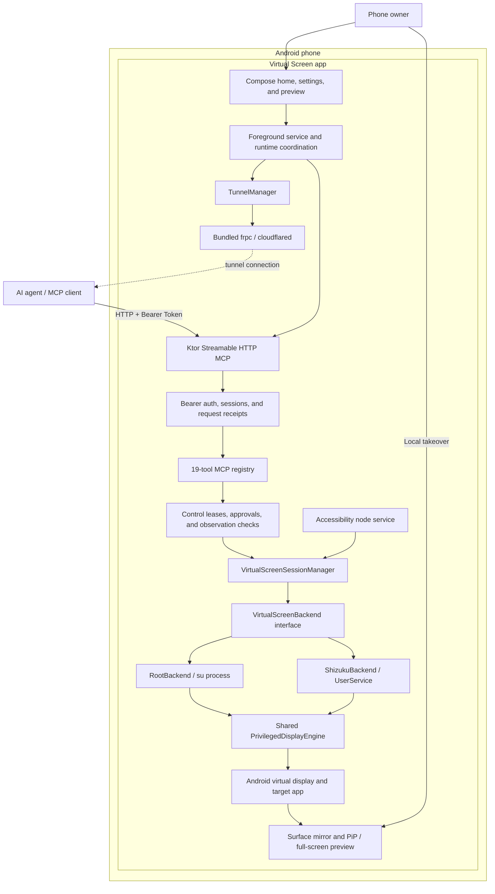

<div align="center">
  
  <h1>Virtual Screen · 虚拟屏</h1>
  <p><strong>A separate Android display for your agent. Your phone stays yours.</strong></p>
  <p><a href="README.md">简体中文</a> · English</p>
  <p>
    <a href="https://github.com/lejw0925/android-virtual-screen/releases/tag/v0.1.0"></a>
    <a href="https://github.com/lejw0925/android-virtual-screen/actions/workflows/build.yml"></a>
    
    <a href="LICENSE"></a>
  </p>
</div>

Virtual Screen is an Android app that gives an AI agent an isolated virtual display and runs an authenticated MCP server on the phone. The agent can discover, launch, and operate apps on that display while you keep using the phone's main screen. You can view, take over, or stop an operation at any time.

<p align="center">
  
  
  
</p>

## Release 0.1.0

Download `virtual-screen-0.1.0.apk` and `SHA256SUMS` from [GitHub Releases](https://github.com/lejw0925/android-virtual-screen/releases/tag/v0.1.0). The app requires Android 13 (API 33) or later and either a working Root `su` or a running, authorized Shizuku service. Device compatibility and background behavior can vary by ROM.

## Features

- **Isolated virtual display.** Agent launches and input are scoped to a display created by this app. Failed operations never fall back to the phone's main screen. Cross-display conflicts require phone approval before an app is restarted.
- **Visible progress and takeover.** PiP shows the remote display; PiP is read-only. Expand the app's full-screen preview or use the notification to take over locally, which revokes the remote control lease.
- **19 MCP tools.** Control, display, app, observation, input, and wait operations. Tree observations can skip screenshots; fresh observation IDs and session receipts reject stale operations and let clients check uncertain results without replaying input.
- **Root and Shizuku.** Both privilege backends share the virtual-display engine, MCP protocol, and input constraints.
- **Flexible connections.** Loopback, LAN, frpc, and Cloudflare Tunnel. MCP and tunnels start disabled; credentials are stored in the app's private encrypted storage.
- **On-device settings.** English, Simplified Chinese, and Traditional Chinese; light and dark themes, dynamic color, onboarding, and local activity logs.

## Get Started

1. Install the [0.1.0 APK](https://github.com/lejw0925/android-virtual-screen/releases/tag/v0.1.0) and install a compatible Root manager or Shizuku. If using Shizuku, start its service first.
2. Open Virtual Screen, select Root or Shizuku under **Permissions and backend**, and grant access. Enable the app's accessibility service for node targeting and Unicode text editing. Allow notifications for approval and takeover actions, and PiP for automatic previews.
3. Enable MCP. For a USB debugging connection, run this on the computer:

   ```sh
   adb forward tcp:8732 tcp:8732
   ```

   The default MCP endpoint is `http://127.0.0.1:8732/mcp`. Enable LAN access in settings for a computer on the same network, or configure frpc or Cloudflare Tunnel for public access.

4. Put the phone-generated Bearer Token in your MCP client configuration:

   ```json
   {
     "mcpServers": {
       "android-virtual-screen": {
         "type": "http",
         "url": "http://127.0.0.1:8732/mcp",
         "headers": {
           "Authorization": "Bearer <phone-generated-token>"
         }
       }
     }
   }
   ```

5. The agent acquires exclusive control, creates a virtual display, discovers and launches an app, observes its nodes or screenshot, and performs actions. Release control when finished. See [MCP integration](docs/MCP.md) for protocol details, tool parameters, and client-specific notes.

## Use Case Diagram



## Architecture



## Security and Behavior Boundaries

- All remote MCP requests require a Bearer Token. Rotating it invalidates old tokens. Do not commit tokens or put them in logs or public messages.
- Device operations require an exclusive lease owned by the current session. Each authorized operation extends its five-minute idle deadline. Expired leases, stale observations, and ambiguous selectors are rejected.
- Input is restricted to the virtual display. Remote PiP only displays the screen; phone touch or notification takeover revokes the remote lease. An agent cannot approve permission dialogs on the phone's main display.
- MCP and tunnels start disabled. LAN and public tunnels increase network reachability; enable them only when needed and protect the client token.
- Accessibility provides node access and assists text entry. Node features are limited without it. Multi-display, PiP, and background behavior varies across apps and ROMs.

## Development and Validation

Use JDK 25 and Android SDK 37 (`platforms;android-37.0`, `build-tools;37.0.0`):

```sh
./gradlew :app:testDebugUnitTest :app:lintDebug :app:assembleDebug
```

Run the same full build used by GitHub Actions:

```sh
./gradlew --no-daemon :app:testDebugUnitTest :app:lintDebug :app:assembleDebug :app:assembleRelease :device-fixture:assembleDebug :app:assembleDebugAndroidTest
```

Actions run JVM tests, Lint, Debug / unsigned Release, fixture, and instrumentation APK builds on `main`, pull requests, and manual dispatch. A matching `vX.Y.Z` or `vX.Y.Z-beta[.N]` tag runs signing and publishes the APK with `SHA256SUMS`; beta tags become GitHub prereleases. Signing material stays in repository secrets. See [Build and release](docs/BUILD.md) for the toolchain and the pinned provenance and build steps for frpc / cloudflared.

See the [changelog](CHANGELOG.md) and [0.1.0 device report](docs/RELEASE_VALIDATION_0.1.0.md) for current fixes and validation. The previous physical Android 17 / HyperOS 4 Root run passed all 19 tools; see [Android 17 and home validation](docs/ANDROID17_FIX_VALIDATION.md). Shizuku's Android 15 emulator results are in [Beta backend comparison](docs/BACKEND_EMULATOR_VALIDATION.md). See [1033 validation](docs/TUNNEL_1033_FIX_VALIDATION.md) for continuous Cloudflare health checks and the 200-second background device test, and [background connection validation](docs/TUNNEL_BACKGROUND_VALIDATION.md) for vendor freezing, the app-specific unrestricted battery setting, and screen-off testing while charging. Unplugged deep Doze and all ROM combinations remain untested. Historical results are in [home layout validation](docs/MCP_HOME_VALIDATION.md) and [release validation](docs/RELEASE_VALIDATION.md).

| Guide | Contents |
| --- | --- |
| [MCP integration](docs/MCP.md) | Authentication, client setup, tools, leases, observations, and receipts |
| [Public tunnels](docs/TUNNELS.md) | frpc, Cloudflare, credentials, and network requirements |
| [Build and release](docs/BUILD.md) | Toolchain, native programs, signing, and GitHub Actions |
| [Release validation](docs/RELEASE_VALIDATION.md) | Device coverage, measurements, and known limits |
| [Getting started and testing](docs/VALIDATION.md) | Authorization and device validation workflows |
| [Contributing](AGENTS.md) | Repository structure, conventions, tests, and security boundaries |

## Credits and License

Parts of the virtual-display engine are adapted from [ETA](https://github.com/Mangi-11/Eta). The UI uses Jetpack Compose Material 3; tunnels use [frp](https://github.com/fatedier/frp) and [cloudflared](https://github.com/cloudflare/cloudflared). Tool design draws on research into [Mobile Next](https://github.com/mobile-next/mobile-mcp), [Android-MCP](https://github.com/CursorTouch/Android-MCP), [android-remote-control-mcp](https://github.com/danielealbano/android-remote-control-mcp), and [PhoneUse](https://github.com/nidhoggfgg/PhoneUse).

Licensed under **[PolyForm Noncommercial 1.0.0](LICENSE)** with upstream Required Notices preserved. See [THIRD_PARTY_NOTICES.md](THIRD_PARTY_NOTICES.md) for component licenses and native provenance.
