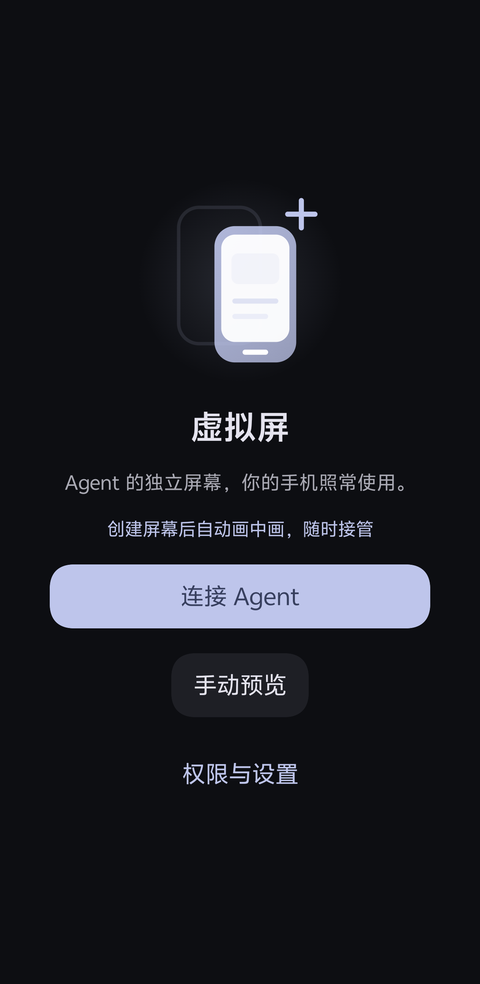
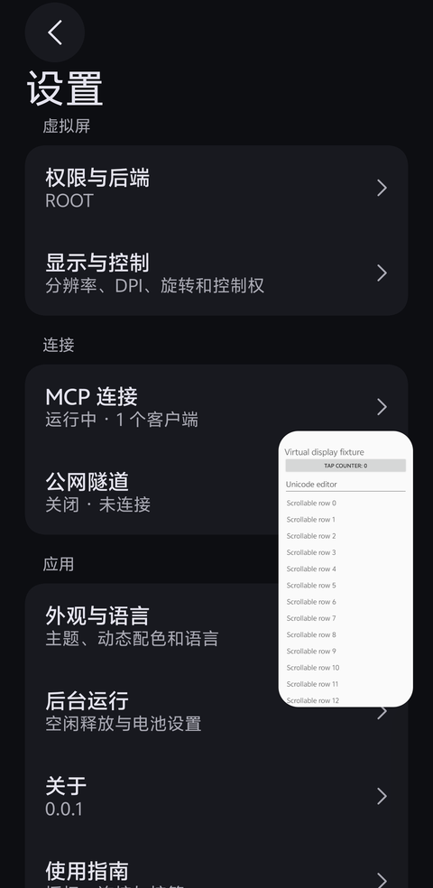
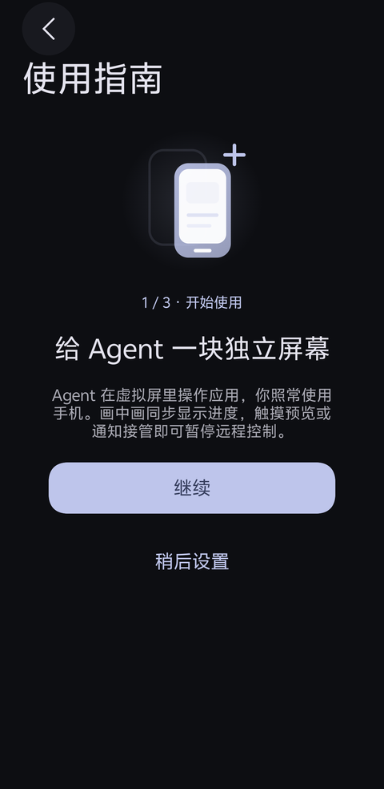
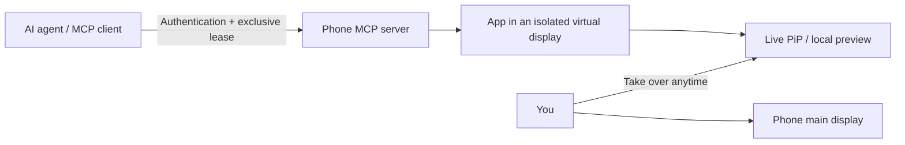

<div align="center">
  
  <h1>Virtual Screen · 虚拟屏</h1>
  <p><strong>A separate screen for your agent. Your phone stays yours.</strong></p>
  <p><a href="README.md">简体中文</a> · English</p>
  <p>
    <a href="https://github.com/lejw0925/android-virtual-screen/releases/latest"></a>
    <a href="https://github.com/lejw0925/android-virtual-screen/actions/workflows/build.yml"></a>
    
    <a href="LICENSE"></a>
  </p>
</div>

Virtual Screen gives an AI agent an independent Android display. Your agent launches and operates apps there while you keep using the phone's main screen. Follow progress in PiP, take over, or stop from the notification. The authenticated MCP server runs on the phone, so a separate desktop phone-control server is unnecessary.

<p align="center">
  
  
  
</p>

## What makes it different

- **Your phone remains usable.** Agent input stays on the display this app created. Failed operations never fall back to the main display. Restarting an app from another display requires confirmation on the phone.
- **Visible progress and immediate takeover.** Remote display creation opens PiP automatically. The notification shows runtime state and the operation's purpose. Expand the preview and touch it, or use the takeover action to revoke remote control.
- **Small, precise tool surface.** Ten MCP tools cover control, displays, apps, observation, input, and waits. Tree-only observations skip image capture; compact nodes, unique selectors, and fresh observation IDs reduce ambiguity.
- **Receipts for uncertain connections.** Input can return a new observation. Results distinguish accepted input from verified effects. Query a session-owned receipt by the original request ID without repeating the input.
- **Choice of connections.** Loopback, LAN, frpc, Cloudflare Quick, or named tunnels. Credentials are encrypted; services and tunnels start disabled.
- **A complete Android app.** Root / Shizuku, live Surface previews, onboarding, English / Simplified Chinese / Traditional Chinese, light and dark themes, and dynamic colors.

## Get started

1. Install the signed APK from [Releases](https://github.com/lejw0925/android-virtual-screen/releases/latest). Requires **Android 13+** with Root or Shizuku already installed.
2. Follow the guide to authorize access. Enable the app's accessibility service for node targeting and Unicode text editing; allow PiP for automatic previews.
3. Enable MCP and paste the copied configuration into your agent's MCP settings. For a computer on the same Wi-Fi network, enable LAN access and use the phone's address. See [MCP setup](docs/MCP.md) for USB development access.
4. Have the agent acquire control, create a display, discover and launch an app, then observe and act. Continue using your phone; take over from the expanded preview or notification whenever needed.

Reopen “Getting started” in Settings. Choose “Manual preview” to try the display locally. Enabling MCP also enables remote control, without a second permission switch.

## How it works



Each input consumes one observation. Expired leases, stale observations, and ambiguous selectors are rejected. Multi-display app behavior, privilege implementations, and background policies vary by ROM. PiP is a viewer; the expanded preview supports direct touch input.

## Validation and development

Three rounds of physical-device UI and MCP workflow iteration were performed on a vivo V2419A running Android 16. Ten samples from the disposable fixture showed lower latency and payload size for tree-only observation than the original screenshot-plus-nodes path. See [0.0.1 validation](docs/RELEASE_VALIDATION.md) for raw measurements, signed release verification, and network limitations; results do not represent every app or device.

Build with JDK 25 and Android SDK 37:

```sh
./gradlew :app:testDebugUnitTest :app:lintDebug :app:assembleDebug
```

GitHub Actions checks commits and pull requests and uploads Debug artifacts. A matching version tag such as `v0.0.1` publishes a signed APK and SHA-256 after checks pass. Signing keys stay outside the repository.

| Guide | Contents |
| --- | --- |
| [Build and signing](docs/BUILD.md) | Toolchain, native binaries, signing, and Actions |
| [MCP integration](docs/MCP.md) | Configuration, tools, observations, and receipts |
| [Tunnels](docs/TUNNELS.md) | frpc, Cloudflare, and network requirements |
| [Device validation](docs/RELEASE_VALIDATION.md) | Iteration, benchmarks, devices, and limitations |
| [Tool research](docs/TOOL_RESEARCH.md) | Pinned source inventories and design decisions |
| [Contributing](AGENTS.md) | Structure, conventions, and required validation |

The detailed developer documents currently use Chinese; commands and machine-readable schemas are shared across languages.

## Credits and license

Parts of the virtual-display engine are adapted from [ETA](https://github.com/Mangi-11/Eta). The UI uses [miuix](https://github.com/compose-miuix-ui/miuix); native tunnels use [frp](https://github.com/fatedier/frp) and [cloudflared](https://github.com/cloudflare/cloudflared). Tool design draws on research into [Mobile Next](https://github.com/mobile-next/mobile-mcp), [Android-MCP](https://github.com/CursorTouch/Android-MCP), [android-remote-control-mcp](https://github.com/danielealbano/android-remote-control-mcp), and [PhoneUse](https://github.com/nidhoggfgg/PhoneUse).

Licensed under **[PolyForm Noncommercial 1.0.0](LICENSE)** with upstream Required Notices preserved. See [THIRD_PARTY_NOTICES.md](THIRD_PARTY_NOTICES.md) for component licenses and native provenance.
