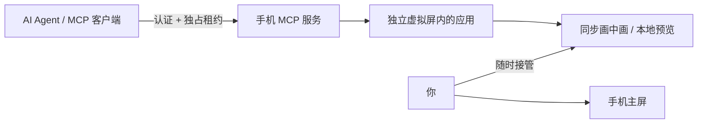

<div align="center">
  
  <h1>虚拟屏 · Virtual Screen</h1>
  <p><strong>Agent 的独立屏幕，你的手机照常使用。</strong></p>
  <p>简体中文 · <a href="README.en.md">English</a></p>
  <p>
    <a href="https://github.com/lejw0925/android-virtual-screen/releases/latest"></a>
    <a href="https://github.com/lejw0925/android-virtual-screen/actions/workflows/build.yml"></a>
    
    <a href="LICENSE"></a>
  </p>
</div>

虚拟屏为 AI Agent 提供一块独立的 Android 显示。Agent 在其中启动和操作应用，你继续使用手机主屏；画中画同步显示进度，通知可随时接管或停止。应用自身提供带认证的 MCP 服务，电脑无需额外安装手机控制服务器。

<p align="center">
  
  
  
</p>

## 为什么使用虚拟屏

- **手机继续由你使用**：所有 Agent 输入限定在本应用创建的显示中；失败时不会回退到主屏。跨屏应用重启需在手机确认。
- **看得见，也能接管**：远程创建屏幕后自动显示画中画；通知显示运行状态和操作目的。展开预览后触摸，或点击通知的接管按钮，即可撤销远程租约。
- **准确而节制的工具**：10 个 MCP 工具覆盖控制、显示、应用、观察、输入和等待。纯节点观察省去截图；精简节点、唯一选择器和新鲜观察标识减少歧义。
- **网络中断有据可查**：操作后可返回新观察；回执区分输入接受和效果确认。按原请求 ID 查询会话回执，查询不会重发输入。
- **连接方式可选**：本机、局域网、frpc、Cloudflare Quick 或固定域名；凭据加密保存，服务和隧道默认关闭。
- **手机上的完整体验**：Root / Shizuku、实时 Surface 预览、首次使用指引、简中 / 繁中 / 英文、深浅色及动态配色。

## 快速开始

1. 从 [Releases](https://github.com/lejw0925/android-virtual-screen/releases/latest) 下载签名 APK。需要 **Android 13+**，并已安装 Root 或 Shizuku。
2. 按首次引导选择访问方式并授权；启用无障碍服务可使用节点定位和 Unicode 文字编辑。允许画中画以自动预览。
3. 开启 MCP，将复制的连接配置粘贴到 Agent 的 MCP 设置。电脑通过同一 Wi-Fi 连接时，开启「局域网访问」并使用手机地址；USB 开发连接见 [MCP 文档](docs/MCP.md)。
4. 让 Agent 申请控制权、创建屏幕、列出并启动应用，再观察和操作。手机主屏可继续使用。需要人工操作时，从预览或通知接管。

设置中可重新打开「使用指南」。只想本地体验时，点击首页「手动预览」。远程接入不需要额外的“允许控制”开关。

## 工作方式



输入消耗一次观察；旧观察、过期租约和不唯一的选择器会被拒绝。应用多屏适配、Root / Shizuku 实现及后台策略因 ROM 而异。画中画本身用于查看，展开后的预览支持本地触摸。

## 验证与开发

在 vivo V2419A / Android 16 上完成三轮界面与真实 MCP 工作流迭代。测试夹具的 10 次采样中，纯节点观察相比旧截图加节点路径降低了响应时间和数据量；完整原始数据、签名发行验证及网络限制见 [0.0.1 验证记录](docs/RELEASE_VALIDATION.md)。这些结果不代表所有应用或设备。

使用 JDK 25 和 Android SDK 37：

```sh
./gradlew :app:testDebugUnitTest :app:lintDebug :app:assembleDebug
```

GitHub Actions 对提交和 PR 执行检查、提供 Debug 产物；版本标签 `v0.0.1` 通过检查后自动签名并发布 APK 和 SHA-256。发行密钥不进入仓库。

| 文档 | 内容 |
| --- | --- |
| [构建与签名](docs/BUILD.md) | 环境、原生构建、发行签名及 Actions |
| [MCP 接入](docs/MCP.md) | 客户端配置、工具参数、观察和回执 |
| [隧道连接](docs/TUNNELS.md) | frpc、Cloudflare 与网络要求 |
| [设备验证](docs/RELEASE_VALIDATION.md) | 三轮迭代、效率数据、设备和限制 |
| [工具调研](docs/TOOL_RESEARCH.md) | 固定源码版本的工具对照与设计依据 |
| [贡献指南](AGENTS.md) | 目录、命名和验证要求 |

## 来源与许可

虚拟显示内核部分改编自 [ETA](https://github.com/Mangi-11/Eta)，界面使用 [miuix](https://github.com/compose-miuix-ui/miuix)，原生隧道来自 [frp](https://github.com/fatedier/frp) 和 [cloudflared](https://github.com/cloudflare/cloudflared)。工具设计参考 [Mobile Next](https://github.com/mobile-next/mobile-mcp)、[Android-MCP](https://github.com/CursorTouch/Android-MCP)、[android-remote-control-mcp](https://github.com/danielealbano/android-remote-control-mcp) 和 [PhoneUse](https://github.com/nidhoggfgg/PhoneUse) 的调研结果。

项目遵循 **[PolyForm Noncommercial 1.0.0](LICENSE)**，保留上游 Required Notice。组件许可、来源和原生二进制溯源见 [THIRD_PARTY_NOTICES.md](THIRD_PARTY_NOTICES.md)。
