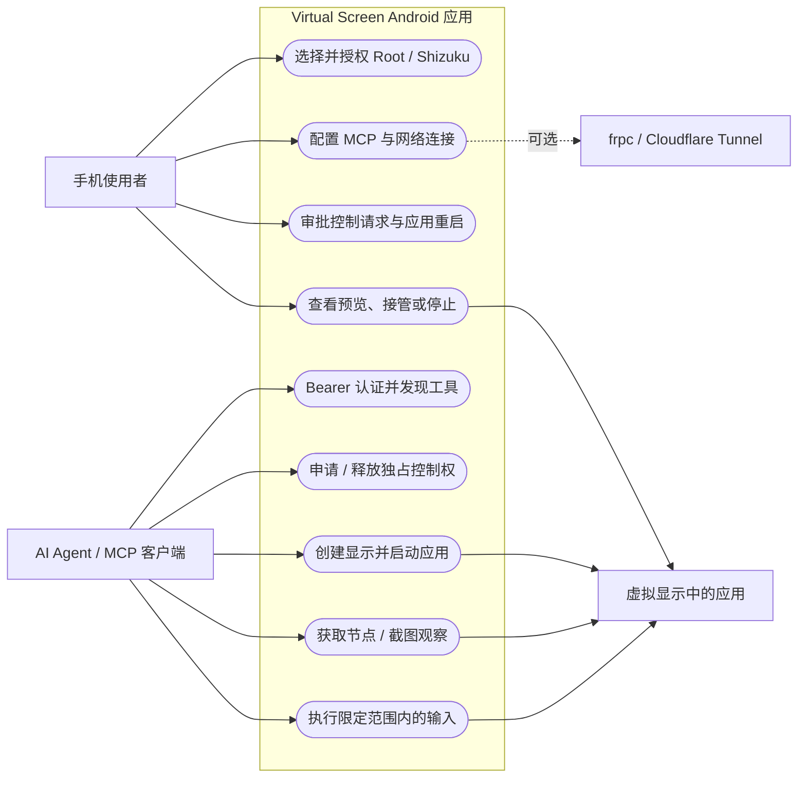
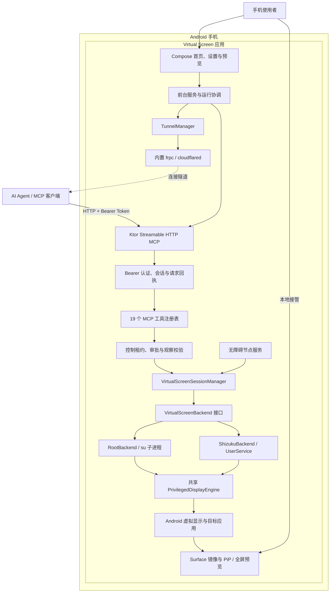

<div align="center">
  
  <h1>虚拟屏 · Virtual Screen</h1>
  <p><strong>Agent 的独立 Android 屏幕，手机主屏继续由你使用。</strong></p>
  <p>简体中文 · <a href="README.en.md">English</a></p>
  <p>
    <a href="https://github.com/lejw0925/android-virtual-screen/releases/tag/v0.1.0"></a>
    <a href="https://github.com/lejw0925/android-virtual-screen/actions/workflows/build.yml"></a>
    
    <a href="LICENSE"></a>
  </p>
</div>

虚拟屏是一款 Android 应用，为 AI Agent 建立独立虚拟显示，并在手机上运行经过认证的 MCP 服务。Agent 可以在虚拟屏中发现、启动和操作应用；你可以继续使用手机主屏，并随时查看、接管或停止操作。

<p align="center">
  
  
  
</p>

## Release 0.1.0

从 [GitHub Releases](https://github.com/lejw0925/android-virtual-screen/releases/tag/v0.1.0) 下载 `virtual-screen-0.1.0.apk` 和 `SHA256SUMS`。安装包要求 Android 13（API 33）或更新版本；需要可用的 Root `su` 或已启动并授权的 Shizuku 服务。设备兼容性和后台策略可能因 ROM 而异。

## 功能

- **独立虚拟显示**：Agent 的启动和输入只作用于本应用创建的显示；操作失败不会回退到手机主屏。跨屏冲突需要手机确认应用重启。
- **随时查看和接管**：画中画显示远程进度；画中画是只读预览。展开应用内全屏预览或使用通知接管后可本地操作，接管会撤销远程控制租约。
- **19 个 MCP 工具**：覆盖控制权、显示、应用、观察、输入和条件等待。树观察可以省略截图；新鲜观察 ID 和会话回执用于拒绝过期操作、查询不确定结果而不重放输入。
- **Root 与 Shizuku**：两种权限后端共用虚拟显示引擎、MCP 协议和输入约束。
- **多种连接方式**：回环地址、局域网、frpc 和 Cloudflare Tunnel。MCP 与隧道默认关闭；凭据保存在应用私有加密存储中。
- **手机端设置**：简体中文、繁体中文和英文；深浅色、动态配色、首次设置引导和本地运行日志。

## 快速开始

1. 安装 [0.1.0 APK](https://github.com/lejw0925/android-virtual-screen/releases/tag/v0.1.0)，并在手机上安装可用的 Root 管理器或 Shizuku。使用 Shizuku 时，先启动其服务。
2. 打开虚拟屏，在「权限与后端」选择 Root 或 Shizuku 并完成授权。启用系统无障碍服务后，可使用节点定位和 Unicode 文本编辑；允许通知以接收操作审批和接管入口；允许画中画以自动显示预览。
3. 开启 MCP。USB 调试连接可在电脑运行：

   ```sh
   adb forward tcp:8732 tcp:8732
   ```

   默认 MCP 地址为 `http://127.0.0.1:8732/mcp`。局域网连接需在设置中启用局域网访问；公网连接可选 frpc 或 Cloudflare Tunnel。

4. 把手机生成的 Bearer Token 放进 MCP 客户端配置：

   ```json
   {
     "mcpServers": {
       "android-virtual-screen": {
         "type": "http",
         "url": "http://127.0.0.1:8732/mcp",
         "headers": {
           "Authorization": "Bearer <phone-generated-token>"
         }
       }
     }
   }
   ```

5. Agent 申请独占控制权，创建虚拟屏，发现并启动应用，然后获取节点或截图观察并执行操作。结束后释放控制权。完整协议、工具参数和客户端差异见 [MCP 接入文档](docs/MCP.md)。

## 用例图



## 架构图



## 安全与行为边界

- 所有远程 MCP 请求都需要 Bearer Token；Token 轮换会使旧 Token 失效。不要把 Token 提交到仓库、日志或公开聊天中。
- 设备操作需要当前会话持有的独占租约。每次有效操作延长五分钟空闲期限；过期租约、旧观察和不唯一选择器会被拒绝。
- 输入严格限定在虚拟显示。远程画中画只展示画面；手机触摸或通知接管会撤销远程租约。Agent 不能代替用户点击手机主屏中的权限对话框。
- MCP 和隧道默认关闭。LAN 与公网隧道会扩大网络可达范围，应只在需要时启用并保护客户端 Token。
- 无障碍服务用于读取节点及辅助文本输入；不启用时可用的节点功能会减少。应用和 ROM 的多屏、画中画及后台行为存在差异。

## 开发与验证

使用 JDK 25 和 Android SDK 37（`platforms;android-37.0`、`build-tools;37.0.0`）：

```sh
./gradlew :app:testDebugUnitTest :app:lintDebug :app:assembleDebug
```

与 GitHub Actions 相同的完整构建命令：

```sh
./gradlew --no-daemon :app:testDebugUnitTest :app:lintDebug :app:assembleDebug :app:assembleRelease :device-fixture:assembleDebug :app:assembleDebugAndroidTest
```

Actions 对 `main`、Pull Request 和手动运行执行 JVM 测试、Lint、Debug / unsigned Release、夹具和 instrumentation APK 构建。推送匹配的 `vX.Y.Z` 或 `vX.Y.Z-beta[.N]` 标签会验证、签名并发布 APK 与 `SHA256SUMS`；Beta 自动标记为 GitHub 预发布版本。签名资料只保存在仓库 Secrets。原生 frpc / cloudflared 的固定来源、校验和及构建方法见 [构建与发布](docs/BUILD.md)。

最新修复与验证汇总见 [变更记录](CHANGELOG.md) 和 [0.1.0 实机验证](docs/RELEASE_VALIDATION_0.1.0.md)。Root 在 Android 17 / HyperOS 4 真机上的历史 19/19 工具检测见 [Android 17 与首页验证](docs/ANDROID17_FIX_VALIDATION.md)；Shizuku 的 Android 15 模拟器结果见 [Beta 后端对照](docs/BACKEND_EMULATOR_VALIDATION.md)。Cloudflare 的持续健康检查与后台 200 秒设备测试见 [1033 验证](docs/TUNNEL_1033_FIX_VALIDATION.md)，厂商后台冻结、应用级「无限制」配置及充电熄屏测试见 [后台断连验证](docs/TUNNEL_BACKGROUND_VALIDATION.md)。断电深度 Doze 和所有 ROM 组合尚未覆盖；历史结果见 [首页适配记录](docs/MCP_HOME_VALIDATION.md) 与 [发行验证](docs/RELEASE_VALIDATION.md)。

| 文档 | 内容 |
| --- | --- |
| [MCP 接入](docs/MCP.md) | 认证、客户端配置、工具参数、租约、观察与回执 |
| [公网隧道](docs/TUNNELS.md) | frpc、Cloudflare、凭据与网络要求 |
| [构建与发布](docs/BUILD.md) | 工具链、原生程序、签名和 GitHub Actions |
| [发行验证](docs/RELEASE_VALIDATION.md) | 实机验证范围、数据和已知限制 |
| [使用指南](docs/VALIDATION.md) | 首次授权和设备验证工作流 |
| [贡献与仓库规范](AGENTS.md) | 项目结构、风格、测试和安全边界 |

## 来源与许可

虚拟显示内核部分改编自 [ETA](https://github.com/Mangi-11/Eta)；界面使用 Jetpack Compose Material 3；隧道程序来自 [frp](https://github.com/fatedier/frp) 和 [cloudflared](https://github.com/cloudflare/cloudflared)。工具设计参考 [Mobile Next](https://github.com/mobile-next/mobile-mcp)、[Android-MCP](https://github.com/CursorTouch/Android-MCP)、[android-remote-control-mcp](https://github.com/danielealbano/android-remote-control-mcp) 和 [PhoneUse](https://github.com/nidhoggfgg/PhoneUse)。

项目使用 **[PolyForm Noncommercial 1.0.0](LICENSE)**，并保留上游 Required Notice。第三方组件许可和原生二进制溯源见 [THIRD_PARTY_NOTICES.md](THIRD_PARTY_NOTICES.md)。
