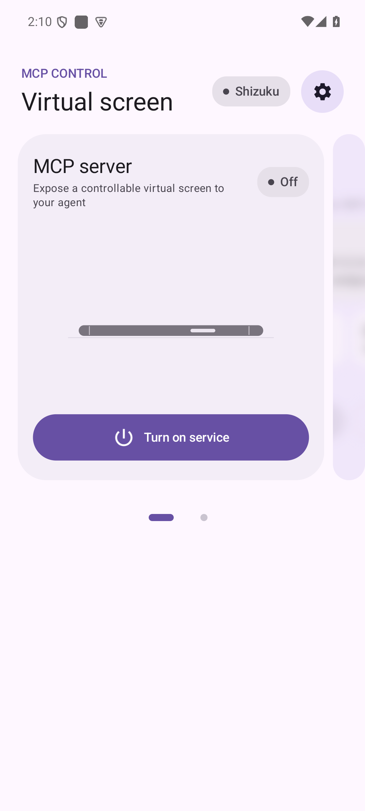
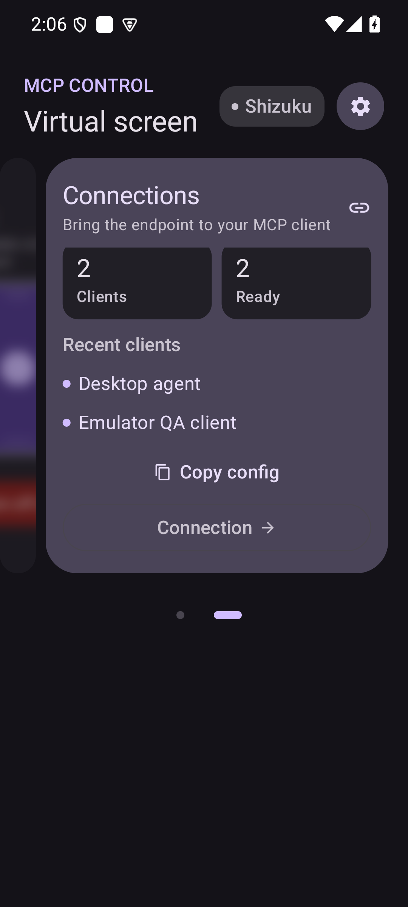
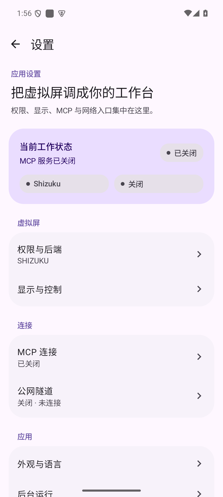

# Material 3 页面审阅记录

本次审阅覆盖启动页、设置首页和设置内的每个页面。全局使用 `MaterialExpressiveTheme`，保留系统/动态配色选择，使用其字体、形状与动效默认值。布局使用 Material 3 的语义层级：页面说明、状态容器、偏好列表、单一主操作和必要的次要操作。页面正文限制最大宽度，手机上保持单列。

参考：[MaterialExpressiveTheme](https://developer.android.google.cn/reference/kotlin/androidx/compose/material3/MaterialExpressiveTheme.composable)、[MotionScheme](https://developer.android.com/reference/kotlin/androidx/compose/material3/MotionScheme)、[Material 3 字体应用](https://m3.material.io/styles/typography/applying-type)。组件按页面任务选用，避免为展示组件而增加无意义操作。

| 页面 | 结构与组件 | 交互检查 |
| --- | --- | --- |
| MCP 首页 | `HorizontalMultiBrowseCarousel` 展示服务与连接两张信息卡；`StatusPill`、`Surface` 端点容器、统计块、`LinearWavyProgressIndicator` 和单一主开关 | 开启/关闭状态、复制配置、连接设置、卡片分页语义 |
| 设置首页 | `SettingsPageHeader` + 当前工作状态容器 + 三组 `PreferenceGroup` | 后端、显示、MCP、隧道、外观、后台、日志、关于、指南入口 |
| 权限与后端 | 后端选择、授权动作、能力状态列表、重新检测 | Root/Shizuku 授权与能力状态分别显示 |
| 显示与控制 | 显示区域、分辨率/DPI、旋转、恢复应用、重建确认 | 重建会话前明确说明远端观察会失效 |
| MCP 连接 | 服务开关、局域网访问、客户端配置、Token、客户端列表 | Token 轮换有确认；点击指定客户端可断开其会话 |
| 公网隧道 | 隧道方式、连接状态、按模式出现的配置、日志与诊断对话框 | 配置未完成时主连接操作保持禁用 |
| 外观与语言 | 主题和语言两个选择列表 | 修改后使用系统语言/动态配色重新组合主题 |
| 后台运行 | 空闲释放、熄屏、系统设置入口、停止全部服务确认 | 停止操作明确列出会关闭的服务 |
| 运行日志 | `FilterChip` 分类、复制/清空操作、可选中文本日志卡片 | 空状态、写入错误、清空确认 |
| 关于与许可 | 版本信息、构建来源、许可证文本 | 许可证内容可滚动阅读 |
| 使用指南 | 两步进度、后端授权、MCP 就绪状态、主操作与稍后设置 | 每步状态和完成条件明确 |

## 模拟器页面检查

2026-10-17，在 Android 15 / API 35 / x86_64 的 1080×2400、420 dpi 模拟器上逐页启动以上 11 个设置目标，检查页面内容及长页滚动；使用指南的两步分别检查。主界面实点启停及轮播分页，关闭后无进度条；保留原有手机立起/横放、波纹和卡片收缩动效。

简中、繁中和英文首页均实际渲染。英文深色主题以 1.3 倍字体检查主按钮、连接卡片、后端选择、显示设置和 Token 确认对话框。两个真实 HTTP 客户端同时连接时，发现最近连接内容被固定卡片裁切，已改为卡片内纵向滚动；1.3 倍字体下两个操作纵向排列，完整显示文字。普通字体和大字体均通过滚动查看两个客户端名称。检查后恢复系统语言、System 主题和 1.0 倍字体。

截图和 UI 层级位于 `build/validation/2026-10-17/ui/`，包括每页的 `settings-*.png/.xml`、启停后的首页、双客户端及大字体修复前后画面。该设备检查不覆盖平板、折叠屏和其他 Android 版本。

| 首页关闭 | 双客户端，大字体滚动到底部 | 设置首页 |
| --- | --- | --- |
|  |  |  |

## 后端验证边界

在 `xhs_test` Android 15/API 35 模拟器上，Shizuku 后端通过真实 HTTP MCP 基础和增强工作流及 4 项设备测试。Root 的 UID 0 引擎通过截图、中文输入和手势命令测试；普通应用无法执行此镜像的 AOSP `su`，完整 Root 应用路径仍待实机补测。详细结果见 [后端对照验证](BACKEND_EMULATOR_VALIDATION.md)。
