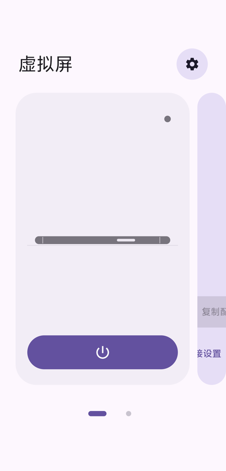
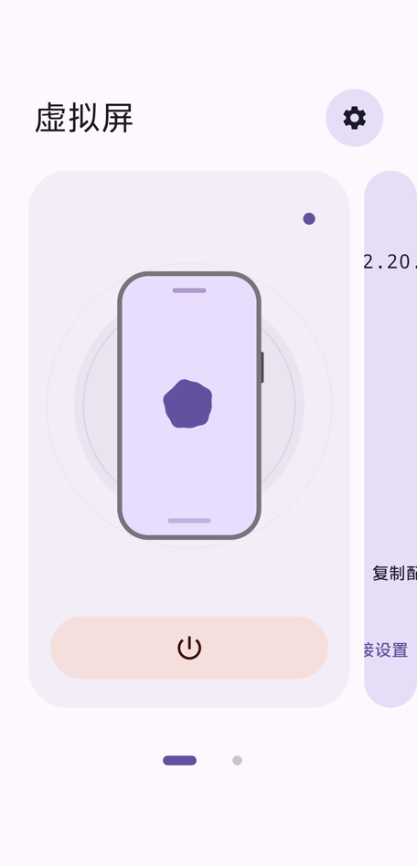
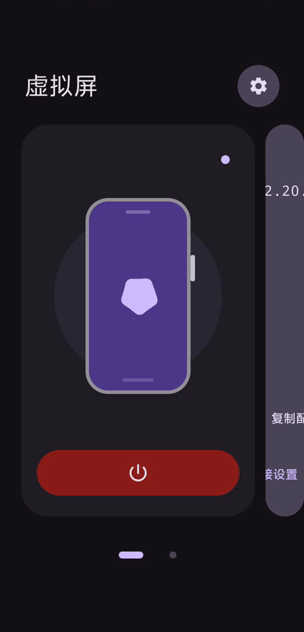
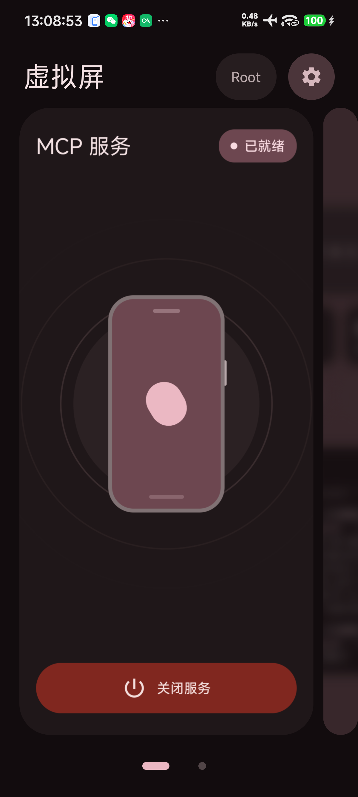
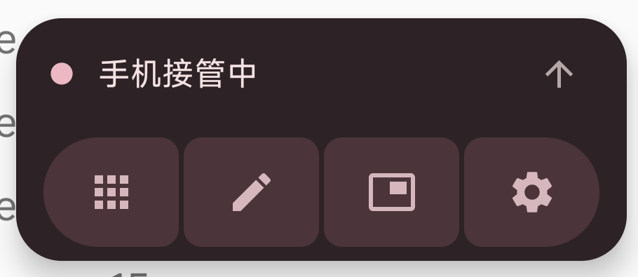
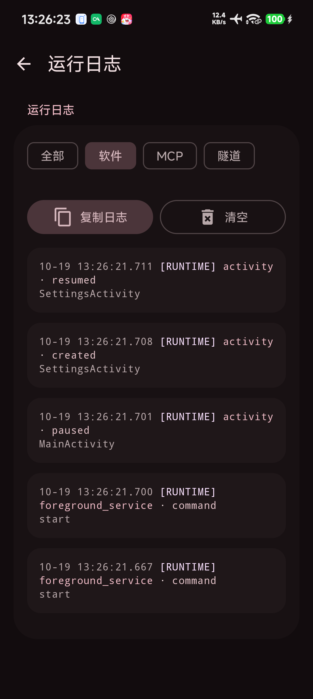
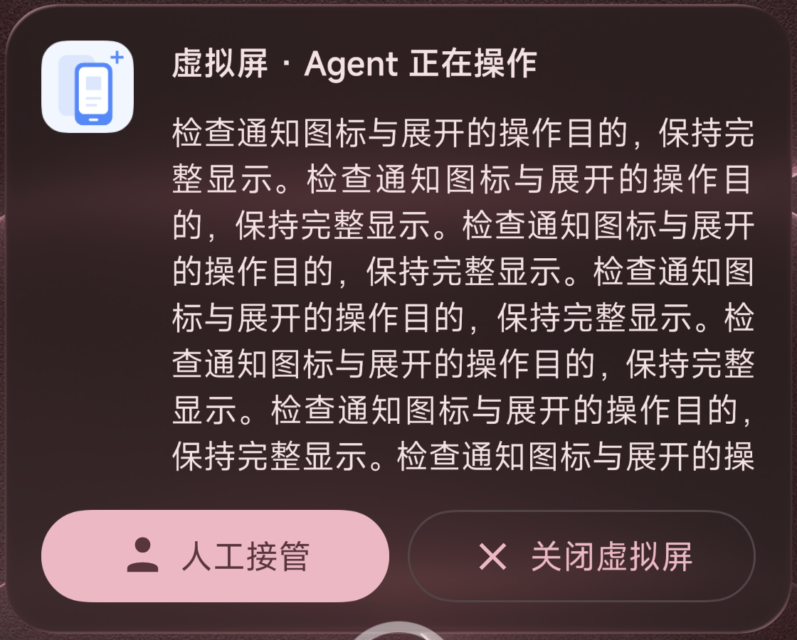
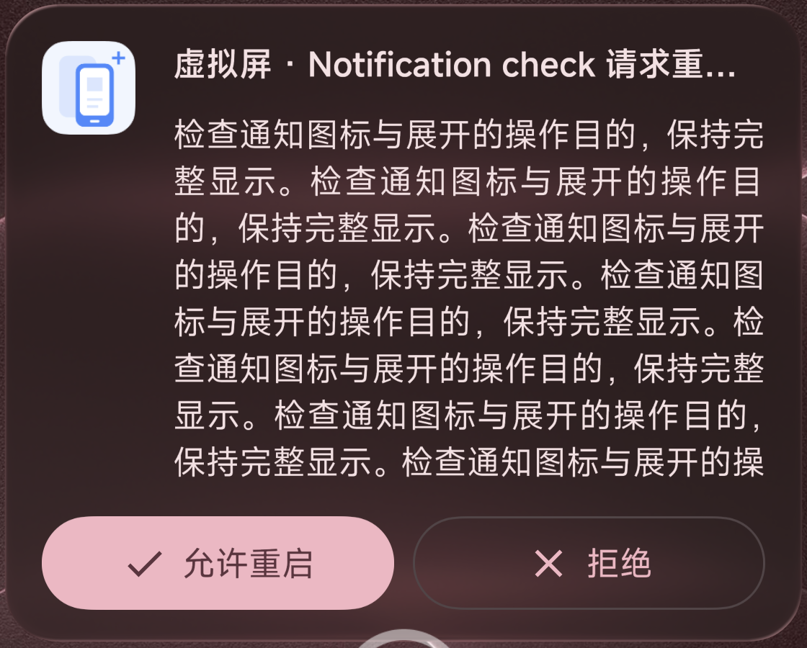

# MCP 首页与动效验证

以下保留 2026-10-16 的实机快照。2026-10-17 的页面层级、带文字的主按钮和全局 Expressive 主题审阅见 [Material 3 页面审阅](MATERIAL3_UI_AUDIT.md)，后端结果见 [模拟器对照验证](BACKEND_EMULATOR_VALIDATION.md)。

日期：2026-10-16。设备：vivo V2419A，Android 16 / API 36，arm64-v8a，USB ADB；后端为已授权的 Shizuku Plus。界面检查只操作本应用。

首页使用 Material 3 原生 Carousel 展示服务与连接卡片。点击手机或电源图标可切换 MCP；按钮没有文字，并按启停状态改变颜色。服务卡右上角用圆点显示关闭、切换中、运行状态，颜色和尺寸平滑过渡。

卡片随横向滚动收缩时，内容平滑缩小至最低 86%，模糊半径增加至最高 12dp，同时叠加最高 36% 不透明度的主题背景色。效果跟随 Carousel 的实际卡片尺寸变化，完全展开时恢复原样。

关闭时手机横放，侧边框使用纯色，只显示侧面及嵌在边框内的单个电源键。开启时手机立起回弹，画面略加长，侧边电源键收薄，中央使用持续转动的原生 LoadingIndicator。运行时背景圆会持续扩散三圈错开的波纹，逐渐放大、淡化；关闭时整体淡出并停止重复动画。关闭时侧面随弹簧落桌后回弹，手机底部不再绘制椭圆阴影。开启 MCP 时原生 LinearWavyProgressIndicator 从下方弹出，操作完成后按八段错时加速落出页面；关闭 MCP 时立即隐藏进度条及其下落动画，并保留占位高度。

设置、权限准备、引导和隧道页的段落说明与静态副标题已移除；引导合并为权限、连接两步。界面保留当前值、错误状态、授权操作、影响确认和开源许可。

## 验证范围

- Debug 构建成功，78 项 JVM 测试通过；Android Lint 0 错误、59 警告。
- 首次同步轮播收缩效果时以该设备现有 APK 为参考，重新构建后对比 `McpHomeKt` 的 64 个方法；排除调试位置信息、生成类编号及 Compose 分组标识后，指令一致。
- 实机点击手机与电源按钮，确认真实 MCP 启停、图标按钮启停配色、侧面电源键和状态圆点；逐帧检查开屏与关屏回弹、电源键厚度、椭圆阴影移除、原生进度条弹出与分段下落，以及运行波纹的扩散、淡化和关闭后的消失。
- 原生 Carousel 可切换到连接卡片；连接地址与客户端数量保留。
- 深色与浅色、1.3 倍字体、简中 / 繁中 / 英文页面检查；恢复原来的 System 主题、跟随系统语言、1.0 倍字体与系统自动旋转。
- USB 转发上的真实 HTTP 初始化、错误 Token 拒绝、带 purpose 的 get_status 及 DELETE 客户端会话通过。
- 本次只改界面；既有租约、观察、显示和后台控制逻辑由 JVM 回归覆盖，没有重跑 Root / 其他 ROM、长时间后台或完整公网隧道矩阵。

## 实机画面

截图裁去系统状态栏，只包含本应用。动图为同一设备上的真实录屏。

| 关闭：侧面与单个电源键 | 开启：立起与原生加载符号 |
| --- | --- |
|  |  |

## 2026-10-17 短屏补验

服务器 AVD 的 1080×1200 短屏窗口下，服务卡和连接卡均按标题和页码之间的剩余高度伸缩。服务卡状态区与主按钮、连接卡入口与操作项都保持居中且完整可见，页码也留在屏幕内。Carousel 不设固定最小高度，卡片内容在空间不足时可在卡内滚动。验证后的 Debug APK 已安装在前台模拟器。

## 2026-10-19 首次提示与卡片内日志

设备：24129PN74C，Android 17 / API 37，arm64-v8a，USB ADB。当前选择 Root 后端，MCP 服务显示已就绪。本次界面检查只操作本应用；用户提供的其他应用画面仅作为视觉参考。

- 首次从首页、引导或设置启用 MCP 时，共用同一后台运行提醒。提醒说明电池不限制、自启动与后台运行对 MCP / 隧道的影响，提供系统设置入口；确认按钮倒计时三秒后解锁。取消不保存确认状态，明确确认后保存到设备设置，再执行既有权限检查。
- 服务控制恢复为卡片底部占满一行、至少 52dp 高的按钮，显示电源图标与“开启服务 / 关闭服务”。手机插画也可点击切换 MCP，恢复按压缩放、开启立起与关闭落桌回弹；切换过程中禁用点击。短屏可在卡片内部滚动，以保留标题与操作入口。
- 服务卡片右下角花瓣背景已移除；手机图标下的浅色底圆保持原来的 96dp 半径；扩散波纹单独使用 128dp 基准半径，比原来扩大约三分之一。三圈波纹继续错开扩散、淡化，停止后整体淡出并释放重复动画。
- 运行日志位于连接卡片内部下半部；连接信息与日志各自滚动。日志沿用经过脱敏的有界历史，以主题主色、次要色、第三色和错误色区分类别、操作、状态及客户端 / IP 字段。代理报告地址保留独立标签。
- 顶部 Root / Shizuku 标志提供至少 48dp 的点击高度，直接进入权限后端设置。新增文案均包含简体中文、繁体中文与英文。

验证：JDK 25、SDK 37；Debug 构建和 Android Lint 通过，Lint 0 错误、65 警告；97 项 JVM 测试通过，无失败或跳过。新版保留数据覆盖安装到上述手机，截图检查运行状态下放大的波纹及底部整行服务按钮。底圆半径与点击交互恢复后重新通过 Debug 构建与 Lint。USB 临时端口转发上的未认证 MCP 请求返回 HTTP 401，并形成日志记录；验证后移除临时转发。

本次没有重跑完整 Root / Shizuku 显示输入、首次提示的自动化实机点击、长时间后台存活或公网隧道矩阵；后台提醒不代替 ROM 自启动及省电策略的实际配置。

## 2026-10-19 悬浮按钮与软件运行日志

- 悬浮栏展开后的应用、输入、画中画、设置四个操作使用原生 Button Group 自定义图标槽，连接式圆角、按压形变，无可见文字。实机无障碍检查四个按钮均保留名称、至少 48dp 点击区域；点击输入成功打开输入框。
- 运行日志加入 `runtime` 软件类别，首页连接卡片和设置页共用同一份历史。记录启动环境、Activity 和前台服务生命周期、无障碍连接 / 中断、权限结果、后端能力变化、虚拟屏和预览状态，以及 MCP / 隧道运行异常。状态未变化的连续观察不产生新记录。
- Java 未捕获异常通过单独原子文件保存，下次启动并入滚动历史后删除；继续调用原有崩溃处理器。记录限量调用栈与错误码，不保存任意异常消息。系统可提供的上次进程退出原因在下次启动后补入，包含 ANR / native crash / 内存不足等原因标签；本次未在实体机主动制造崩溃、ANR 或内存压力。
- 日志页增加软件筛选，完整日志也使用主题色区分类别与级别。复制诊断报告包含设备、版本、后台限制、权限和服务当前状态，以及当前筛选日志；实机确认复制报告不包含 MCP Token。

验证：同一台 Root 手机保留数据安装；102 项 JVM 测试全部通过（新增 5 项日志回归），Debug 构建与 Lint 通过，Lint 0 错误、65 警告。临时 instrumentation 检查软件筛选、可见运行事件和复制诊断报告后已卸载；没有更改设备权限或清空原有日志。

## 2026-10-19 无障碍授权与实时通知

- “权限与后端”页显示无障碍设置和服务绑定状态，包含一键 Root / Shizuku 授权与系统设置入口。Home 与设置返回时刷新系统实际授权状态。自动启用会检查应用服务是否绑定，必要时重绑；成功或失败以 Snackbar 告知，失败时直接提供手动开启入口。
- Android 16 QPR1 / API 36.1 及更高版本允许在通知设置开启原生 Live Updates。只有活动虚拟屏会话请求系统晋升为状态栏 Chip，状态随本机运行或远程 Agent 操作变化；通知提供收起胶囊操作。MCP 空闲等待使用普通前台通知。是否显示由系统权限、系统界面和厂商策略决定。

验证：Android 17 / API 37 Root 手机查看首页状态图标与无障碍设置入口；自动 Root 启用的成功、无权限失败 Snackbar 和系统设置跳转通过临时 instrumentation 验证，检查仅添加本应用服务并保留设备上原有的其他无障碍服务。API 37 原生通知构建检查返回 `requested=true`、`eligible=true`，手机的实时通知授权检查为允许；Chip 实际显示仍由 Android 系统界面决定。115 项 JVM 测试通过；Debug 构建和 Lint 0 错误、64 警告。实机确认授权状态、成功 Snackbar 和两类系统设置入口。

## 2026-10-19 实时通知状态图标与审批内容

- 状态图标区分操作中（手指）、远程中（电脑）、本机运行（手机）、待审批（盾牌）、异常（警告）。当前控制方操作完成后继续显示其最新 purpose，避免短操作结束就丢失目的；其他控制方的内容不会混入。
- 活动虚拟屏通知提供带图标的“人工接管”“关闭虚拟屏”；关闭绑定原会话，只关闭虚拟屏和租约，保留 MCP 与隧道。控制审批改为“允许一次／始终允许／拒绝”，重启审批为“允许重启／拒绝”，保留原有两分钟有效期和手机确认机制。Android 17 请求图标加文字及主次按钮样式。
- 保留原生 BigTextStyle 和晋升资格，不使用自定义 RemoteViews。Android 原生 Live Updates 模板不支持应用控制跑马灯，长 purpose 保留原文并多行显示，最终可见行数由系统决定。

验证：121 项 JVM 测试通过，包括通知状态、长 purpose、审批动作隔离及过期通知不能关闭新屏幕。最终 Debug 与 Lint 通过，Lint 0 错误、64 警告。Android 17 / API 37 手机保留数据安装；local / remote / working / control_approval / restart_approval 五种原生构建均 eligible=true、purpose_preserved=true，按钮包含实际 icon，图标加文字样式提示为 true。锁屏通知实机确认工作状态和重启审批的按钮图标可见；截图仅保留本应用通知，预览通知随后移除。实际审批仍由原有请求管理器校验，不在测试中自动批准用户应用重启。Root 实机创建 fixture 虚拟屏并发送运行通知本身的“关闭虚拟屏” PendingIntent 后，状态 STOPPED、MCP 仍运行，Cloudflare 子进程继续存活并完成 PUBLIC_ORIGIN_VERIFIED。更新安装重启服务后已重新连接 Quick Tunnel，临时地址随新进程更新。

| 运行目的与接管／关闭 | 重启审批与允许／拒绝 |
| --- | --- |
|  |  |
